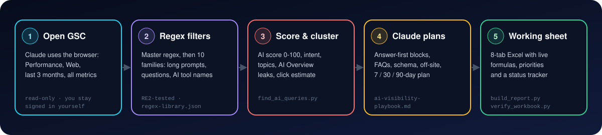
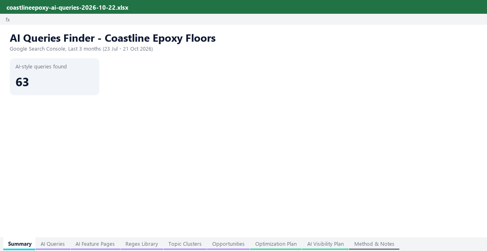

<div align="center">



<br/>

[](CHANGELOG.md)
[](LICENSE)
[](#-see-the-working-sheet)
[](references/gsc-browser-workflow.md)

[](#-quick-start)
[](references/regex-library.md)
[](requirements.txt)
[](CONTRIBUTING.md)

### Find the AI prompts hiding in your Search Console, and get a plan to win them.

[**🚀 Quick start**](#-quick-start) · [**🔤 Regex library**](references/regex-library.md) · [**📊 Sample report**](examples/sample-report.xlsx) · [**🧠 SKILL.md**](SKILL.md)

</div>

---

## ✨ What it does

People now type **whole sentences** into Google AI Mode, AI Overviews and AI assistants: *"i have cracks in my garage floor can i still get epoxy coating"*, then follow up with *"show me photos"* and *"which is cheaper?"*. Those prompts show up in Search Console mixed in with ordinary keywords, and Search Console's **Generative AI features** report shows which pages AI answers use. This skill reads both and tells you what to do.

<table>
<tr>
<td width="33%" valign="top">

### 🌐 Reads GSC for you
Claude opens **Search Console in your browser** with ready-made links (Web · last 3 months · all metrics), reads your totals, Pages and the **Generative AI features** report. Read-only, and you stay signed in yourself.

</td>
<td width="33%" valign="top">

### 🔤 Filters with regex
A **library of 12 tested regexes** (plus one master regex) catches long prompts, questions, "help me / compare / explain" requests, first-person context, **AI Mode follow-ups**, AI-tool mentions and **AI-agent searches**.

</td>
<td width="33%" valign="top">

### 🚀 Builds the plan
Every query is scored, clustered by topic and prioritised. Claude writes **answer-first blocks, question headings, FAQs, schema and off-site actions** per topic, plus a **7 / 30 / 90-day AI visibility plan**.

</td>
</tr>
</table>

Every number comes from your GSC data. Nothing promises a citation: the plan raises the odds and tells you how to measure it.

---

## ⚙️ How it works

<div align="center">

</div>

| Step | What happens | Tool |
|:-:|---|---|
| 1 | Claude opens GSC with direct links (`--gsc-urls`): **Web**, **last 3 months**, all four metrics; reads totals, Pages and the **Generative AI features** report | Browser |
| 2 | Applies the **master regex** through the URL (single families past the 1,000-row cap) and reads the queries | Browser + [`regex-library.json`](references/regex-library.json) |
| 3 | Scores each query 0-100, tags intent, clusters topics, separates **follow-ups** and **agent searches**, maps AI-shown pages to topics, estimates clicks | `find_ai_queries.py` |
| 4 | Checks who AI already cites for the top topics, then writes the plan | [`ai-visibility-playbook.md`](references/ai-visibility-playbook.md) |
| 5 | Builds the Excel working sheet and checks it: zero formula errors, regexes RE2-safe, answer blocks 40-60 words | `build_report.py` · `verify_workbook.py` |

---

## 🔤 The regex library

Paste these into **GSC > Performance > + Add filter > Query > Custom (regex)**. All are tested against Google's RE2 engine (no lookaheads, under 4,096 characters) and were run on a live property. "near me" searches are deliberately **not** matched.

| ID | Family | Catches | Example |
|:-:|---|---|---|
| R01 | Long prompt (10+ words) | Full-sentence prompts | *i want a durable garage floor that looks good and is easy to clean* |
| R02 | Conversational (7-9 words) | Longer than a keyword, shorter than a prompt | *how long does epoxy garage floor last* |
| R03 | Question opener | what, how, why, can, should, is... | *is epoxy flooring slippery when wet* |
| R04 | Instruction / request | give me, explain, compare, help me, I need... | *give me a checklist for preparing a garage floor* |
| R05 | First-person context | my, I, we, our | *my garage floor gets wet in summer* |
| R06 | Comparison | vs, alternatives, difference between | *epoxy vs polished concrete* |
| R07 | Recommendation / best-of | best, top 10, worth it, should I buy | *what is the best epoxy for garage floors* |
| R08 | Constraints & specifics | for beginners, under $500, step by step | *step by step epoxy floor for beginners* |
| R09 | How / why / is-it reasoning | how long, why does, is it worth, do I need | *why is epoxy flooring so expensive* |
| R10 | AI tool mention / leaked prompt | ChatGPT, Gemini, Perplexity, URL-prefixed prompts | *chatgpt epoxy garage floor cost australia* |
| R11 | Follow-up / context-less prompt | AI Mode follow-ups with no topic word, anything ending in ? | *show me photos* · *which is cheaper?* |
| R12 | Search operators (AI agents & tools) | site:, intitle:, -site: lists, quoted phrases - reported, not optimised | *"epoxy flooring" -site:reddit.com* |

<details>
<summary><b>📋 Master regex, copy-paste ready (click to expand)</b></summary>

<br/>

```
(?i)^\S+(\s+\S+){9,}$|^\S+(\s+\S+){6,8}$|^(who|whom|whose|what|whats|what's|when|where|why|how|which|is|are|was|were|am|can|could|should|would|will|do|does|did|has|have)\s|^(give|show|tell|help|explain|list|compare|recommend|suggest|find|create|write|generate|make|summarise|summarize|describe|plan|calculate|teach|guide|walk|act|pretend|please|i need|i want|im looking|i'm looking|i am looking|looking for|can you|could you)\b|\b(i|im|i'm|ive|i've|my|we|our)\b|\b(how (to|do|does|can|long|much|many|often)|why (is|do|does|are|would)|what (is|are|does|happens|should)|is it (safe|worth|possible|legal|true|normal|ok|okay|better)|does it|can i|should i|do i need)\b|(chatgpt|chat gpt|openai|gpt-?[0-9]|gemini|claude|perplexity|copilot|ai overview|ai mode|\bllm\b|https?:?\s?//|www\.|\.com/)|(^(how about|what about|and what|show (me )?(photos|pics|pictures|images|designs|examples?|an example)|show (photos|pics|pictures|images)|can (you|i) (see|show)|give (me )?(images|pics|photos|examples)|which (is|one|more)|are they|is it|is that|what if|why does it|how much (would|approximately|to get)|whats? the (cheapest|cost|best))\b|\?$)|(\bsite:|\bintitle:|\binurl:|\bfiletype:|\s-site:|^\"[^\"]+\"|\s-\"[^\"]+\")
```

Every family regex, the scoring weights and worked examples: [`references/regex-library.md`](references/regex-library.md).

</details>

> [!NOTE]
> Search Console labels AI-feature impressions **by page** (Generative AI features report) but not by query. The regexes find the queries by their **shape** (length, phrasing, intent). Google hides rare queries, and long prompts are rare, so the regex view undercounts: the skill uses both.

---

## 📊 See the working sheet

<div align="center">

<br/><sub><i>Built from the fictional sample data in <a href="examples">examples/</a>. Download <a href="examples/sample-report.xlsx">sample-report.xlsx</a> to click around.</i></sub>
</div>

<br/>

<details>
<summary><b>📑 All 9 tabs (click to expand)</b></summary>

<br/>

| # | Tab | What's in it |
|:-:|-----|--------------|
| 1 | 🏠 **Summary** | AI-feature impressions, AI-style queries, impressions, clicks, CTR, share of site impressions, follow-ups, agent searches, click opportunity, top topics, quick wins |
| 2 | 🤖 **AI Queries** | Every query: words, AI score, tier, regex families matched, intent, topic, metrics, position bucket, AI Overview flag, action, click estimate |
| 3 | ✨ **AI Feature Pages** | Every page Google's AI features showed: AI impressions, share, Search impressions, position, AI share of the page, matching topic, what to do |
| 4 | 🔤 **Regex Library** | Every regex ready to copy, its length, weight and live counts of the queries and impressions it caught |
| 5 | 🧭 **Topic Clusters** | Topics ranked by priority with live totals, CTR, position, AIO leaks, intent mix, pages and top queries |
| 6 | 🎯 **Opportunities** | The 50 queries with the most to gain, with action type and estimated extra clicks |
| 7 | ✍️ **Optimization Plan** | Per topic: target URL, diagnosis, 40-60 word answer block (live word count), question headings, FAQ, table/steps, schema, internal links, off-site actions, status |
| 8 | 🚀 **AI Visibility Plan** | Quick wins (days 1-7), then 30- and 90-day actions with effort, impact, owner, status and how to measure it |
| 9 | 📐 **Method & Notes** | Date range, thresholds, how scoring and clustering work, the AIO rule, caveats, data warnings |

Green cells are suggestions to review. Amber cells are yours to fill in.

</details>

---

## 🚀 Quick start

> [!IMPORTANT]
> The browser part needs a Claude that can use a browser: **Claude in Chrome**, the **Claude desktop app** (built-in browser) or **Claude Code** with a browser tool. Be signed in to Google first. Claude never types passwords and asks before downloading the export.
> No browser? Export from GSC yourself (steps in [`gsc-browser-workflow.md`](references/gsc-browser-workflow.md)) and attach the zip.

### In Claude (claude.ai / desktop app)
1. Download [`ai-queries-finder.skill`](ai-queries-finder.skill).
2. Upload it in Claude's **Skills** settings (code execution needs to be on).
3. Start a chat and say:

```text
Find the AI queries in my Search Console for sc-domain:example.com (last 3 months)
and give me a strategy to increase AI visibility. Brand: Example Co. Areas: Gold Coast, Brisbane.
```

Claude asks you to sign in to Google in its browser if needed (it never types passwords), then reads everything itself.

### In Claude Code
```bash
git clone https://github.com/akifseospecialist-digitalmarketer/ai-queries-finder.git \
  ~/.claude/skills/ai-queries-finder
pip install -r ~/.claude/skills/ai-queries-finder/requirements.txt
```
Then ask Claude Code to "run ai-queries-finder on my GSC property example.com".

### Without Claude (scripts only)
Steps 3 and 5 run anywhere. Step 4, writing the strategy, is the part an AI (or you) does.
```bash
pip install -r requirements.txt
python3 scripts/find_ai_queries.py --gsc-urls "sc-domain:example.com"   # ready-to-open GSC links
python3 scripts/find_ai_queries.py examples/sample-gsc-export.zip \
  --ai-pages examples/sample-gsc-ai-features-pages.tsv --ai-total 5400 --pages examples/sample-gsc-pages.tsv \
  -o work/ai-queries.json --brand "coastline epoxy" --locations "gold coast,southport" --total-impressions 412000
python3 scripts/build_report.py --data work/ai-queries.json --strategy examples/sample-strategy.json \
  -o outputs/report.xlsx --md outputs/summary.md
python3 scripts/verify_workbook.py outputs/report.xlsx
```

---

## 🧮 How queries are scored and flagged

| Signal | Rule (defaults, adjustable) |
|---|---|
| **AI score** | Sum of the weights of every regex family the query matches, capped at 100. **High** ≥ 50, **Medium** ≥ 30; AI-style = 30+ (`--min-score`) |
| **Topic** | Words used across most of the site's queries (your core topic) are background. Each query joins the topic of its question type (cost, timing, care, problems, safety, DIY, choosing) or its most specific shared word |
| **AI Overview likely** | Position ≤ 5, 20+ impressions, CTR under 40% of what that position should earn: the answer is probably summarised above you |
| **AI Mode follow-up** | Matches R11, 8 words or fewer, and uses no word the site's other queries use ("show me photos") |
| **Agent search** | Matches R12 (`site:`, `intitle:`, quoted): listed, never given a click estimate or a content plan |
| **Page topic** | Each AI-shown page joins the topic whose head word (or concept, e.g. cost → "cost", "price") is in its URL |
| **Action type** | Top 3 → defend & get cited · 4-10 → answer upgrade · 11-20 → striking distance · 21+ → content gap |
| **Est. extra clicks** | Impressions × expected CTR at the target position − current clicks (conservative curve) |

---

## 🛡️ Rules baked in

- 🔒 **Read-only in GSC**: never changes settings, never types passwords, asks before downloading
- ✅ **RE2-tested regexes**: `--check-regex` and `verify_workbook.py` block anything GSC would reject
- 🧾 **Answer blocks 40-60 words** that answer in the first sentence, checked before delivery
- 🚫 **No invented facts**: prices, stats and years become `[placeholders]` listed under "Check before publishing"
- 🎯 **One page per topic**: no thin pages for every long prompt, no keyword-stuffed FAQs
- 🤝 **No promises**: says what raises the odds of being cited and how to measure it
- 🧮 **Formulas, not hard-coded totals**: shares, CTRs, word counts and click estimates update as you edit

---

## 🎛️ Customising

| Want to... | Do this |
|---|---|
| A stricter AI list | `--min-score 50` |
| Drop one-off long prompts on a big site | `--min-impr 5` |
| Keep brand searches out of the topics | `--brand "acme,acme co"` |
| Mark local intent | `--locations "gold coast,brisbane"` |
| Show the share of site impressions | `--total-clicks` and `--total-impressions` from GSC with no filter |
| Add or tune a regex | Edit [`regex-library.json`](references/regex-library.json), then `--check-regex` |

---

## 📁 Repo structure

```
.
├── SKILL.md                      ← the skill: workflow Claude follows
├── ai-queries-finder.skill       ← installable package (SKILL.md + scripts + references)
├── scripts/
│   ├── find_ai_queries.py        ← score, tag, cluster, map AI pages; --gsc-urls / --print-regex / --check-regex
│   ├── build_report.py           ← the 9-tab Excel working sheet + markdown summary
│   └── verify_workbook.py        ← formula errors, RE2 safety, answer-block length
├── references/
│   ├── regex-library.json        ← the regexes + weights (single source of truth)
│   ├── regex-library.md          ← the same, readable, with examples
│   ├── gsc-browser-workflow.md   ← GSC URL parameters, the two reports, reading tables, snags (tested live)
│   └── ai-visibility-playbook.md ← answer engineering, technical, off-site, measurement, fast-track order
├── examples/                     ← fictional epoxy-flooring business: exports, AI pages, strategy, finished report
├── assets/                       ← banner, diagram, workbook preview
├── requirements.txt
├── CHANGELOG.md · CONTRIBUTING.md · LICENSE
└── .gitignore                    ← keeps client exports and reports out of the repo
```

---

## 🧰 Requirements

| Need | Notes |
|---|---|
| Google Search Console access | Owner, full or restricted user on the property |
| A browser tool for Claude | Claude in Chrome, the desktop app's browser, or computer use. Otherwise upload the export yourself |
| Python 3.9+ | `pandas`, `openpyxl` (see `requirements.txt`) |
| Optional | Web search (checks who AI cites), LibreOffice (formula check in `verify_workbook.py`) |

---

## 📄 License

MIT. See [LICENSE](LICENSE). The sample data in `examples/` is fictional.

## 👋 About

Created by **Akif Qureshi | SEO Specialist & Digital Marketer**
🌐 [algoblueprints.com](https://algoblueprints.com)

More skills: [Website Clicks Improver](https://github.com/akifseospecialist-digitalmarketer/website-clicks-improver) · [SEO · AEO · GEO Audit & Working Sheet](https://github.com/akifseospecialist-digitalmarketer/seo-aeo-geo-audit-and-working-sheet) · [GSC Opportunity Finder](https://github.com/akifseospecialist-digitalmarketer/claude-ai-gsc-opportunity-finder) · [AI Prompt Research](https://github.com/akifseospecialist-digitalmarketer/claude-ai-prompt-research-skill) · [SEO Master](https://github.com/akifseospecialist-digitalmarketer/seo-master-skill)
